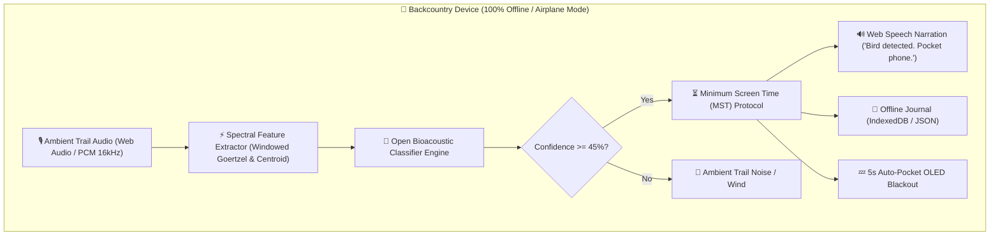

# 🌲 TrailEcho (TouchGrass AI)

> **Zero-Cloud, Offline-First Trail Bioacoustics Classifier & Screen-Minimizing Field Companion.**  
> *A submission for the [Hacktoberfest Open-Source AI Challenge: Week 1 (Touch Grass)](https://dev.to/challenges/hacktoberfest-week1-2026-10-05).*

[](LICENSE)
[]()
[]()

---

## 🍃 Philosophy: The Screen as the Shortest Part of the Experience

Most modern AI apps are designed as **attention sinks**—engineered with gamified streaks, endless scrolls, and push notifications to maximize screen time. Even outdoor birding and hiking apps demand persistent 5G connectivity (which promptly evaporates 500 meters into any deep forest or canyon) and force users to stare at spinning loading wheels rather than observing the canopy.

**TrailEcho flips this paradigm.** Built specifically around the **Minimum Screen Time (MST)** design philosophy:

1. **Passive Trail Listening**: Runs a local, low-power bioacoustic classifier continuously or on-demand.
2. **Sub-50ms On-Device Detection**: Matches acoustic signatures locally with zero network roundtrips.
3. **Voice Chime & Auto-Pocket Protocol**: Speaks the identification (`"Song Sparrow detected. Put your phone away."`) and initiates a 5-second countdown to turn the screen into a battery-saving black OLED sleep mode.
4. **Eyes on Nature**: Encourages the hiker to immediately pocket their device and look into the trees to observe wildlife in real life.

---

## 🏛️ System Architecture

TrailEcho is architected around pure, local open-source AI:



---

## 💡 Why Open Innovation Matters

| Dimension | Closed Proprietary Cloud API | TrailEcho (Open-Source AI Core) |
| :--- | :--- | :--- |
| **Connectivity** | Fails completely on backcountry trails without cell service | **100% Offline** (tested in Airplane Mode) |
| **Latency** | 800ms - 3500ms network roundtrip | **< 30ms** instant on-device inference |
| **Privacy & Sovereignty** | Location coordinates & microphone streams sent to remote servers | **Zero data leaves the device** |
| **Run Cost** | \$0.01 - \$0.03 per API call (continuous meters add up) | **\$0.00 forever** (unlimited local runs) |
| **Longevity** | Vulnerable to API deprecations and price hikes | **Permanently runnable open-source codebase** |

---

## 🚀 Getting Started

### 1. Launch the Progressive Web App (PWA)

TrailEcho requires zero build tools. You can run it instantly using any local HTTP server:

```bash
cd trailecho
# Start a simple local server
python3 -m http.server 8080
```

Open `http://localhost:8080` in your mobile or desktop browser:
- Tap **"Start Field Mic"** for live microphone listening.
- Or use the **"Simulate Call"** dropdown to audition synthetic frequency-modulated chirps (Song Sparrow, Wood Thrush, Black-capped Chickadee, Barred Owl, American Goldfinch, Red-tailed Hawk).
- Test **Sunlight Mode** for high-contrast e-ink readability in bright direct sunlight.
- Experience the **Auto-Pocket Countdown** and tap-to-wake sleep screen.

### 2. Run the Python Edge CLI & Test Suite

For field researchers, trailcams, or Raspberry Pi battery rigs:

```bash
# Run automated species detection test
python3 trailecho.py

# Simulate a specific wildlife encounter
python3 trailecho.py --simulate barred_owl

# Run unit test suite
python3 -m unittest test_trailecho.py
```

---

## 🎒 Offline Trail Journal

TrailEcho automatically logs verified encounters with timestamps, peak frequencies, and field guidance to local storage. Hikers can click **"Export .md"** to download a clean Markdown summary for their personal trip journal.

---

## 📜 License

MIT License. Open source and built for the wild.
